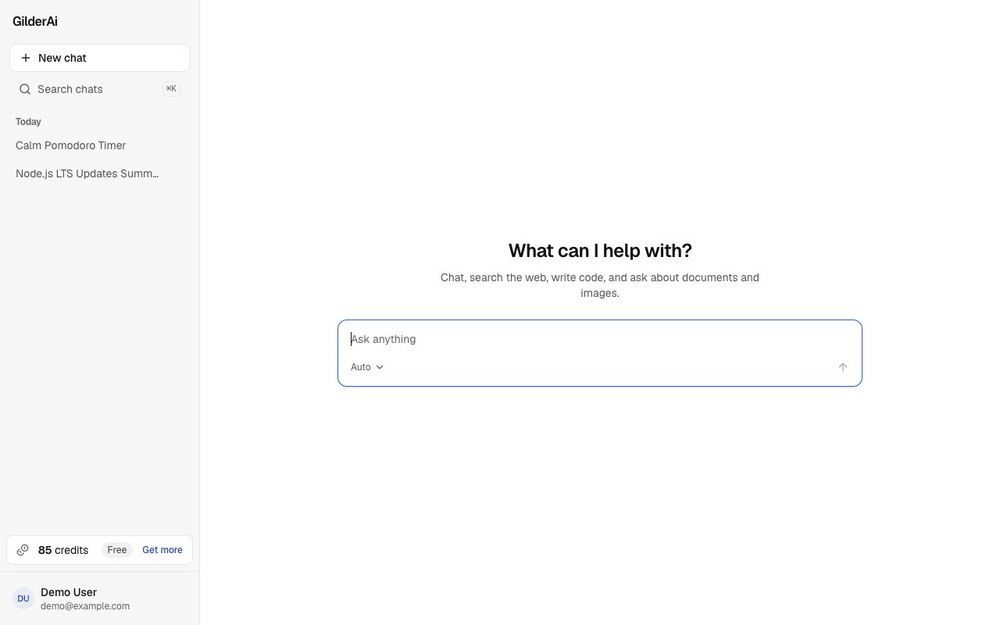
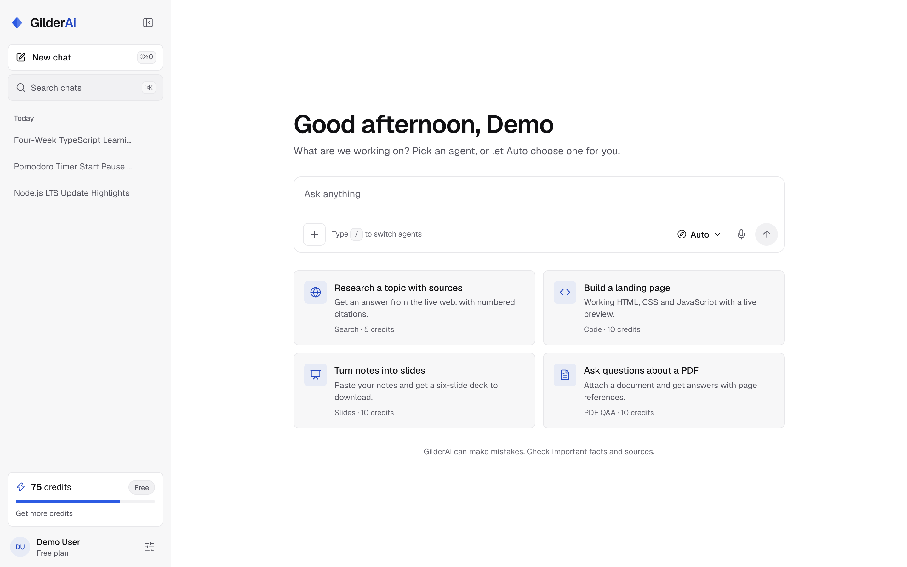
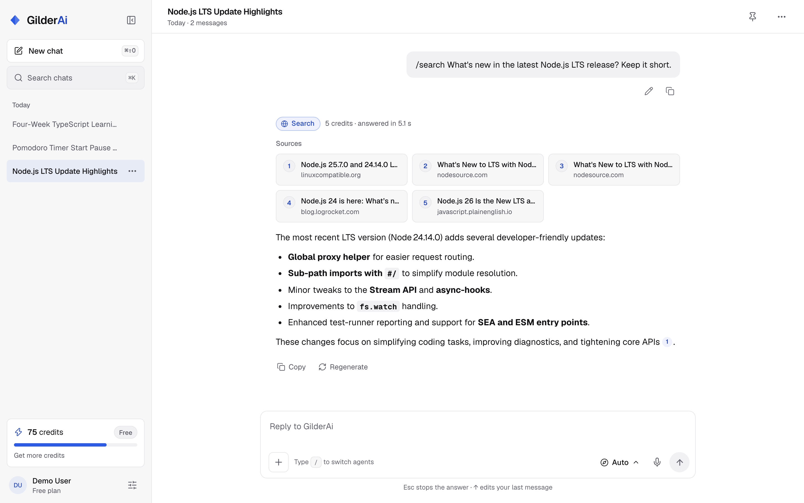
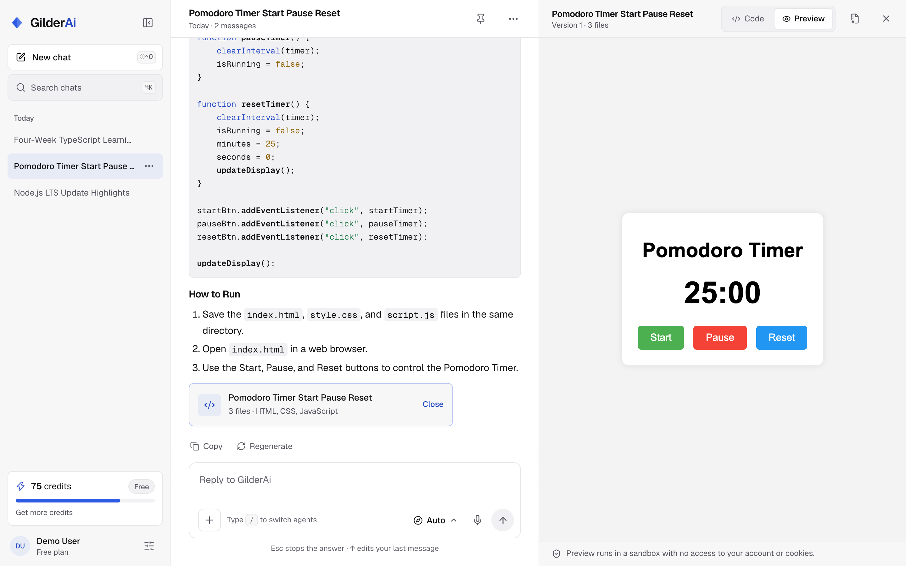
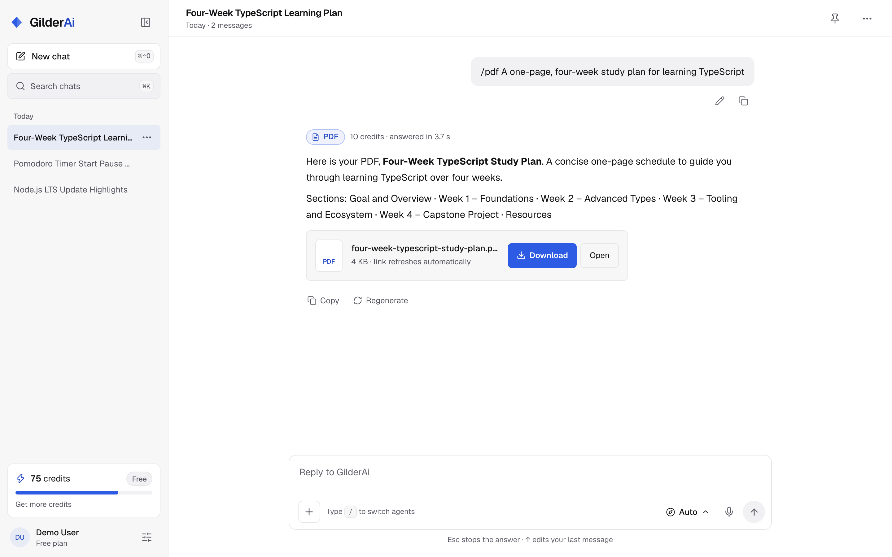
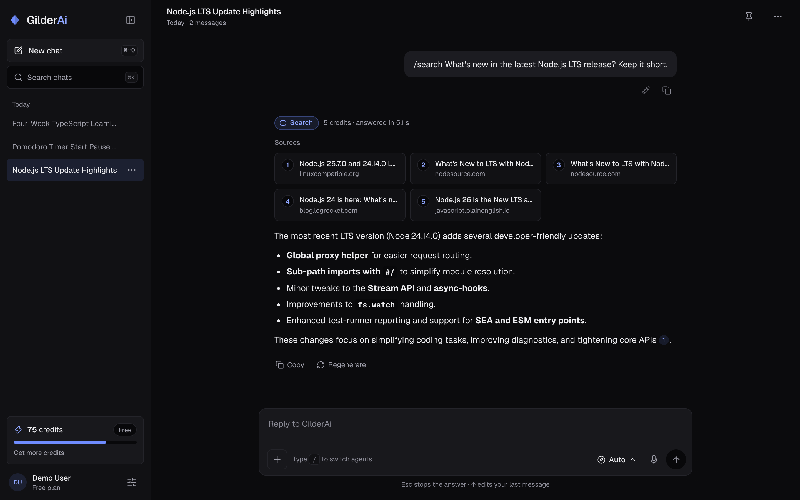
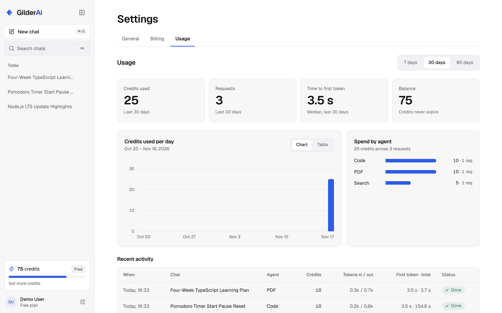
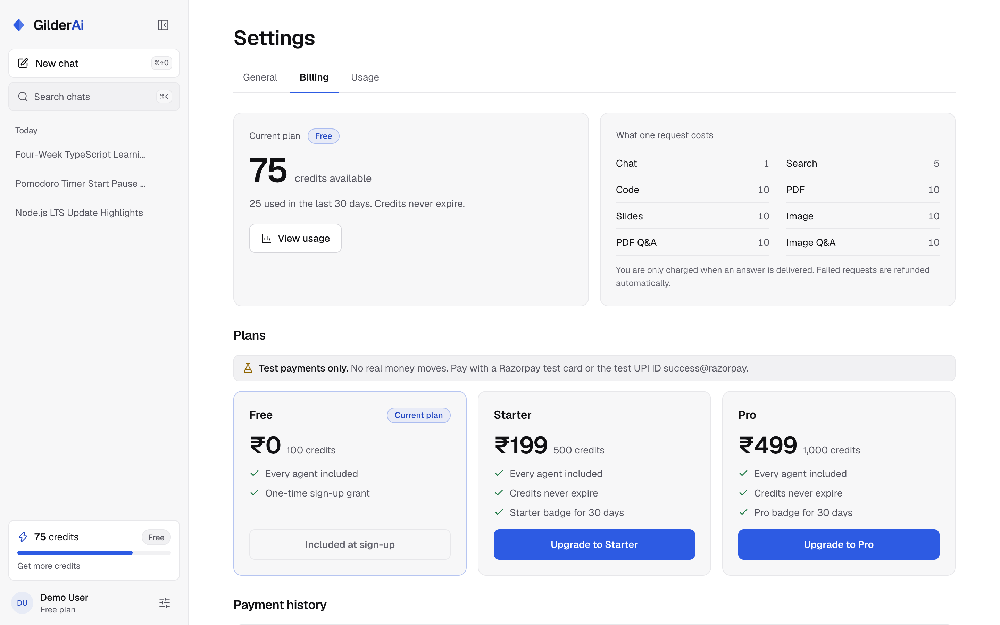
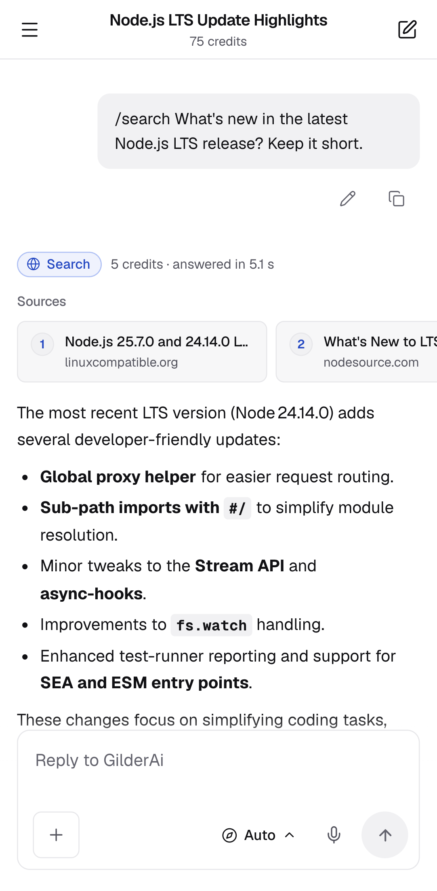
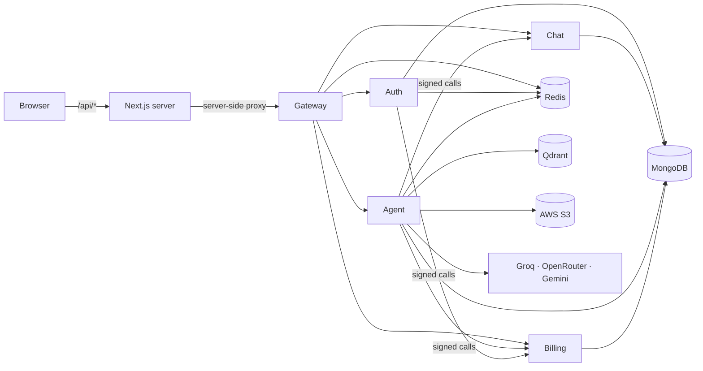

# GilderAi

A multi-agent AI workspace. One chat interface sends each request to the right specialist: conversation, web search with sources, code with a live preview, PDF, slide and image generation, and questions about your own PDFs and images. Answers stream token by token and are paid for with credits that can never be overdrawn.



## Features

- **Auto-routing across 8 agents.** A small, fast model picks the agent for each message, or you choose one from the menu or with a shortcut: `/search`, `/code`, `/pdf`, `/slides`, `/image`.
- **Streaming answers** with stop, regenerate and edit-and-resend. A stop works even when the answer is being written by another server instance. Each answer shows its agent, what it cost and how long it took.
- **Web search** answers with source cards and numbered citations.
- **Code projects** split into files, in a panel beside the chat with a sandboxed live preview, copy and download as a zip.
- **PDF, slide and image generation** with live progress. The model fills a checked outline and the server draws the file, so an answer can't put scripts or links into it.
- **Questions about your PDFs** with page citations, and questions about images.
- **Credits** reserved before each answer and settled afterwards, backed by a ledger. Plans can be bought through Razorpay (test mode).
- **Usage dashboard** (credits per day and by agent, time to first token) and printable payment receipts.
- **Voice input**, chat search (⌘K), pin and rename, light and dark themes, and a phone layout.

## Screenshots

| New chat                                                                              | Web search with sources                                                          |
| ------------------------------------------------------------------------------------- | -------------------------------------------------------------------------------- |
|          |               |
| **Code with a live preview**                                                          | **Generated PDF**                                                                |
|  |                  |
| **Dark theme**                                                                        | **Usage**                                                                        |
|                     |  |
| **Billing (test mode)**                                                               | **On a phone**                                                                   |
|                    |        |

## How it works



- **Secrets stay on servers.** The browser talks only to the Next.js app, whose server forwards API calls to the gateway. The gateway and services have no public port.
- **One front door.** The gateway checks the session cookie, origin and rate limits (per IP and per user), then signs a short-lived EdDSA token for each call it forwards. Services reject anything without one, and each internal route accepts only the callers it expects (for example, only the agent service may spend credits).
- **Each service owns its data.** Separate MongoDB databases; services talk over HTTP.
- **An answer, step by step:** a per-message lock (so a double click can't answer twice) → balance check → attachment checks → recent messages as memory → routing → per-agent rate limit → credits reserved → the answer streams over server-sent events → credits committed (or released if it failed or was stopped).
- **Credits can't go negative.** A reservation is one conditional update inside a transaction, every change is a ledger entry with a unique key (so a retried payment or webhook can't grant twice), and a sweeper returns holds that were never settled. Tests check that the balance always equals the ledger minus open holds.
- **AI providers behind one layer.** A small, fetch-based client for OpenAI-compatible APIs, with a fallback model for each route (fallback only before the first token, so an answer is never stitched from two models) and timeouts for the start and for silence mid-stream. Every call's model, tokens and timing is recorded for the usage page.
- **Files are checked twice.** Uploads go straight to S3 through presigned forms limited by type and size; the server then reads the file's first bytes to confirm what it really is. Storage keys are built from IDs only, and download links are fresh 5-minute links.

## Tech stack

| Layer    | Choice                                                                                                 |
| -------- | ------------------------------------------------------------------------------------------------------ |
| Frontend | Next.js 16 (App Router, Cache Components), React 19, Redux Toolkit + RTK Query, Tailwind CSS 4 + Radix |
| Backend  | Node.js 22 (runs TypeScript directly), Express 5: gateway + auth, chat, agent and billing services     |
| Data     | MongoDB + Mongoose, Redis, Qdrant, AWS S3                                                              |
| AI       | Groq, OpenRouter and Gemini (OpenAI-compatible APIs), Gemini embeddings, Tavily search, Pollinations   |
| Payments | Razorpay (orders, signature checks, webhooks), test mode                                               |
| Quality  | TypeScript, ESLint, Prettier, Vitest + Supertest, Playwright + axe, GitHub Actions                     |
| Deploy   | Docker, Docker Compose, Caddy (automatic HTTPS), GitHub Container Registry                             |

## Getting started

**Requirements:** Node.js 22 (`nvm use` reads `.nvmrc`), pnpm (`corepack enable pnpm`) and Docker.

```bash
pnpm install      # every app in the workspace
pnpm setup:env    # creates each app's .env from its .env.example (keeps existing ones)
pnpm setup:keys   # generates the signing keys the apps use to trust each other
pnpm infra:up     # MongoDB, Redis and Qdrant in Docker, waits until healthy
pnpm dev          # frontend :3000, gateway :8000, services :8001–8004
```

The agent service starts with `LLM_MODE=mock`: answers and search results are canned, so the app runs without any AI keys (uploads and generated files still need an S3 bucket). To sign in locally, set `AUTH_DEV_LOGIN=true` in `backend/services/auth/.env` (refused in production builds) and use the dev sign-in form.

**Optional keys** turn on the live features. Each goes in the `.env` of the app named:

| Feature                        | Keys                                                                    | App      |
| ------------------------------ | ----------------------------------------------------------------------- | -------- |
| Live answers (`LLM_MODE=live`) | `GROQ_API_KEY`, `OPENROUTER_API_KEY`, `GEMINI_API_KEY`                  | agent    |
| Web search                     | `TAVILY_API_KEY`                                                        | agent    |
| Uploads and generated files    | `AWS_REGION`, `S3_BUCKET`, `AWS_ACCESS_KEY_ID`, `AWS_SECRET_ACCESS_KEY` | agent    |
|                                | `S3_BUCKET_ORIGIN`                                                      | frontend |
| Google sign-in                 | `FIREBASE_PROJECT_ID`, `FIREBASE_CLIENT_EMAIL`, `FIREBASE_PRIVATE_KEY`  | auth     |
|                                | `NEXT_PUBLIC_FIREBASE_*`                                                | frontend |
| Payments (test mode)           | `RAZORPAY_KEY_ID`, `RAZORPAY_KEY_SECRET`, `RAZORPAY_WEBHOOK_SECRET`     | billing  |
|                                | `NEXT_PUBLIC_RAZORPAY_KEY_ID`                                           | frontend |

| Command                             | What it does                                       |
| ----------------------------------- | -------------------------------------------------- |
| `pnpm dev`                          | Run the frontend and every backend app with reload |
| `pnpm build`                        | Production build                                   |
| `pnpm test`                         | Run every app's unit and integration tests         |
| `pnpm lint` / `pnpm typecheck`      | ESLint / TypeScript checks                         |
| `pnpm format` / `pnpm format:check` | Format with Prettier / check formatting            |
| `pnpm infra:up` / `infra:down`      | Start / stop local MongoDB, Redis and Qdrant       |
| `pnpm infra:ps` / `infra:logs`      | Status and logs of the local infrastructure        |
| `pnpm docs:dev`                     | Run the docs explorer on :3100                     |

**Local ports:** MongoDB `27018`, Redis `6380`, Qdrant `6335`. They're non-standard so they don't clash with other local projects.

## Testing

- **Unit and integration tests** (Vitest + Supertest) run each service against an in-memory MongoDB replica set and a real Redis, including the credit invariants, webhook signatures, stream events and the gateway's guards.
- **End-to-end tests** (Playwright) drive the real app in a browser, on desktop and a phone-sized screen: signing in and out, a streamed first message that names its chat, regenerate, web search with sources, credits and billing. axe checks every main page and fails on serious accessibility issues.
- **CI** (GitHub Actions) runs formatting, lint, types, tests and builds, then starts the whole stack in mock mode and runs the end-to-end tests against it.

```bash
cd e2e && pnpm exec playwright test   # with the app running locally (dev sign-in on)
```

## Deployment

The whole app runs on one server with Docker Compose, behind Caddy:

- **Two images.** One backend image runs the gateway and every service from their TypeScript sources (no build step); the web image uses Next.js standalone output.
- **One public service.** Caddy gets and renews the HTTPS certificates and passes the answer stream through without buffering. MongoDB (a single-node replica set, for transactions), Redis, Qdrant and the apps share an internal network.
- **Deploys** run from GitHub Actions by hand: build both images, push them to GitHub's container registry tagged with the commit, copy the Compose files to the server and restart.
- **Backups:** `deploy/backup.sh` copies MongoDB to S3 nightly from cron and keeps a week of copies on the server.
- **Monitoring:** `GET /api/health` answers 200 only when the web server reaches a ready gateway (503 otherwise), so one uptime monitor covers Caddy, the web server, the gateway and Redis.

[`deploy/README.md`](deploy/README.md) walks through putting the app on a fresh server, and lists the everyday commands.

## Project layout

```
frontend/                 Next.js app
backend/gateway/          public API entry: sessions, origin checks, rate limits, signed forwarding
backend/services/         auth, chat, agent, billing
backend/shared/           code shared by the backend apps
backend/docker-compose.yml  local MongoDB, Redis and Qdrant
deploy/                   production Compose stack, Caddy config, backup script
e2e/                      Playwright end-to-end tests
docs-explorer/            interactive map of this codebase (separate app)
```

## License

[MIT](LICENSE) © 2026 Nayan Ingale
