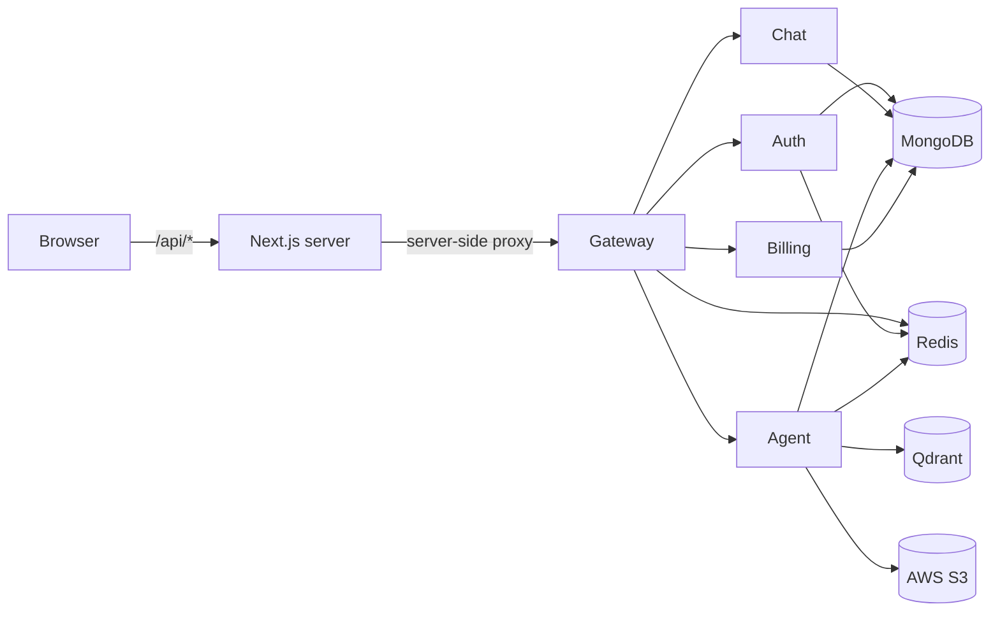

# GilderAi

A multi-agent AI workspace. One chat interface sends each request to the right specialist agent: conversation, web search with sources, code with a live preview, PDF and slide generation, image generation, and questions about your own PDFs and images.

> **Status:** in development. The backend foundation is in place; features are being added one by one.

## Planned features

- Auto-routing across 8 agents, or pick one yourself (also with `/search`, `/code`, `/pdf`)
- Streaming answers with stop, regenerate and edit-and-resend
- Web search answers with numbered, clickable sources
- Multi-file code projects with a sandboxed live preview
- PDF, slide and image generation with live progress
- PDF Q&A with page citations, and image Q&A
- Credits that can't be overdrawn, backed by a ledger, plus Razorpay plans (test mode)
- Usage dashboard, chat search, pin and rename, and light and dark themes

## Architecture



- **Secrets stay on servers.** The browser only talks to the Next.js app, whose server proxies API calls to the gateway.
- **One front door.** The gateway checks sessions and rate limits, then signs a short-lived token for each internal call; services reject anything without one.
- **Each service owns its data.** Separate MongoDB databases; services talk over HTTP.

## Tech stack

| Layer    | Choice                                                                                 |
| -------- | -------------------------------------------------------------------------------------- |
| Frontend | Next.js (App Router), React 19, Redux Toolkit + RTK Query, Tailwind CSS 4 + Radix      |
| Backend  | Node.js 22 (runs TypeScript directly), Express 5: gateway + auth, chat, agent, billing |
| Data     | MongoDB + Mongoose, Redis, Qdrant, AWS S3                                              |
| AI       | LangGraph; Groq, OpenRouter, Gemini, Tavily, Pollinations                              |
| Quality  | TypeScript, ESLint, Prettier, Vitest + Supertest, GitHub Actions                       |

## Getting started

**Requirements:** Node.js 22 (`nvm use` reads `.nvmrc`), pnpm (`corepack enable pnpm`) and Docker.

```bash
pnpm install     # every app in the workspace
pnpm setup:env   # creates each app's .env from its .env.example (keeps existing ones)
pnpm infra:up    # MongoDB, Redis and Qdrant in Docker, waits until healthy
pnpm dev         # frontend :3000, gateway :8000, services :8001–8004
```

| Command                             | What it does                                       |
| ----------------------------------- | -------------------------------------------------- |
| `pnpm dev`                          | Run the frontend and every backend app with reload |
| `pnpm build`                        | Production build                                   |
| `pnpm test`                         | Run every app's tests                              |
| `pnpm lint` / `pnpm typecheck`      | ESLint / TypeScript checks                         |
| `pnpm format` / `pnpm format:check` | Format with Prettier / check formatting            |
| `pnpm infra:up` / `infra:down`      | Start / stop local MongoDB, Redis and Qdrant       |
| `pnpm infra:ps` / `infra:logs`      | Status and logs of the local infrastructure        |
| `pnpm docs:dev`                     | Run the docs explorer on :3100                     |

**Local ports:** MongoDB `27018`, Redis `6380`, Qdrant `6335`. They're non-standard so they don't clash with other local projects.

**Project layout:**

```
frontend/                 Next.js app
backend/gateway/          public API entry
backend/services/         auth, chat, agent, billing
backend/shared/           code shared by the backend apps
backend/docker-compose.yml
docs-explorer/            interactive map of this codebase (separate app)
```

## License

[MIT](LICENSE) © 2026 Nayan Ingale
